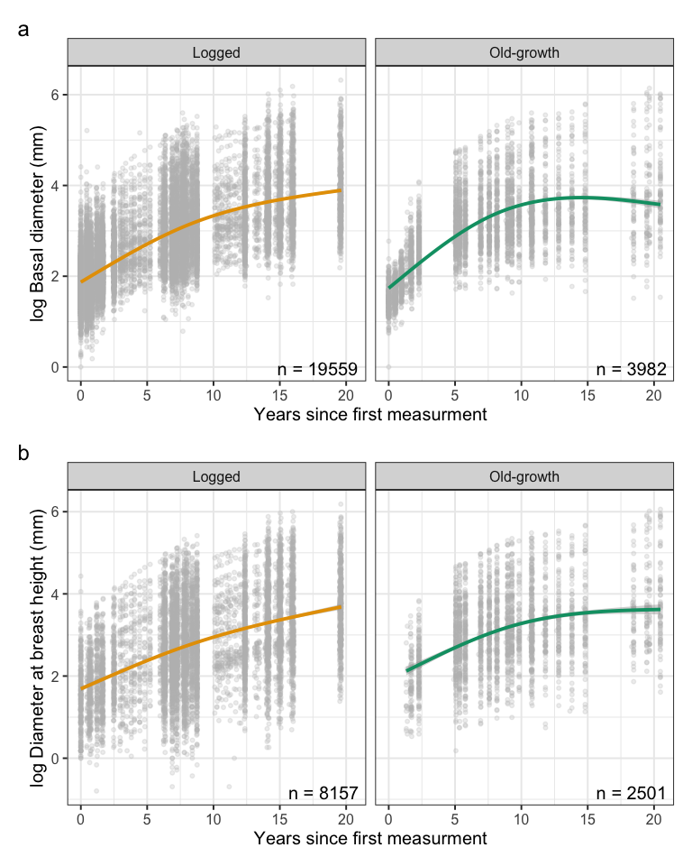

# Does DBH growth data largely reflect the same trajectories as basal diameter?

13 November, 2026

``` r
library("tidyverse")
library("patchwork")

clean_data <- read_rds(here::here(
    "data",
    "derived",
    "data_cleaned.rds"
)) |>
    mutate(
        forest_type = case_when(
            grepl("logged", forest_type) ~ "Logged",
            grepl("primary", forest_type) ~ "Old-growth"
        )
    )
```

``` r
pal <-
    c("Logged" = "#e69f00", "Old-growth" = "#009e73")

sample_sizes <-
    clean_data |>
    summarise(
        dbase_n = sum(is.finite(years) & is.finite(dbase_mean) & dbase_mean > 0),
        dbh_n = sum(is.finite(years) & is.finite(dbh_mean) & dbh_mean > 0),
        .by = forest_type
    )

p1 <-
    clean_data |>
    ggplot(aes(y = log(dbase_mean), x = years, colour = forest_type)) +
    geom_point(alpha = 0.25, shape = 20, colour = "grey") +
    theme(legend.position = "none") +
    geom_smooth(
        method = "gam",
        formula = y ~ s(x, bs = "cs", k = 3),
        method.args = list(method = "REML", gamma = 1.5)
    ) +
    labs(
        x = "Years since first measurment",
        y = "log Basal diameter (mm)"
    ) +
    facet_wrap(~forest_type) +
    scale_colour_manual(values = pal) +
    geom_text(
        data = sample_sizes,
        aes(x = Inf, y = -Inf, label = paste0("n = ", dbase_n)),
        inherit.aes = FALSE,
        hjust = 1.1,
        vjust = -0.5
    )

p2 <-
    clean_data |>
    ggplot(aes(y = log(dbh_mean), x = years, colour = forest_type)) +
    geom_point(alpha = 0.25, shape = 20, colour = "grey") +
    theme(legend.position = "none") +
    geom_smooth(
        method = "gam",
        formula = y ~ s(x, bs = "cs", k = 3),
        method.args = list(method = "REML", gamma = 1.5)
    ) +
    labs(
        x = "Years since first measurment",
        y = "log Diameter at breast height (mm)"
    ) +
    scale_colour_manual(values = pal) +
    facet_wrap(~forest_type) +
    geom_text(
        data = sample_sizes,
        aes(x = Inf, y = -Inf, label = paste0("n = ", dbh_n)),
        inherit.aes = FALSE,
        hjust = 1.1,
        vjust = -0.5
    )
```

``` r
p1 / p2 + plot_annotation(tag_levels = "a")
```



Seedling (a) basal diameter and (b) diameter at breast height (DBH) over
time in logged and old-growth forests. Points show individual
measurements; lines show generalized additive model fits, with shaded
95% confidence intervals. Sample sizes indicate the number of plotted
measurements in each panel.

``` r
clean_data |>
    filter(
        is.na(survival) | survival != 0,
        !is.na(dbase_mean) | !is.na(dbh_mean)
    ) |>
    summarise(
        total_entries = n(),
        across(
            c(dbase_mean, dbh_mean),
            list(
                missing = \(x) sum(is.na(x)),
                proportion = \(x) mean(is.na(x))
            )
        )
    )
```

    # A tibble: 1 × 5
      total_entries dbase_mean_missing dbase_mean_proportion dbh_mean_missing
              <int>              <int>                 <dbl>            <int>
    1         23502                  0                     0            12851
    # ℹ 1 more variable: dbh_mean_proportion <dbl>
